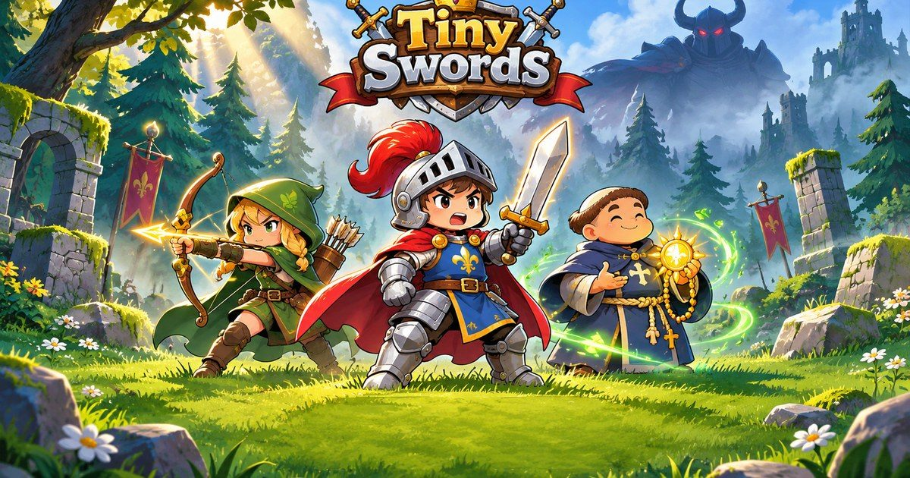

# Tiny Swords: Arena Survivor



My **first game**, built with **Godot 4** in about **one week** as a learning journey into 2D game development. Arena survival gameplay using the [Tiny Swords](https://pixelfrog-assets.itch.io/tiny-swords) 2D asset pack by Pixel Frog.

## Play Now

- **Web version (Vercel):** https://tinyswordsweb.vercel.app/
- **Android APK:** https://github.com/MhdRasal/TinySwordsWeb/releases/latest/download/TinySwords-v1.0.0.apk

The web build runs directly in the browser (desktop and mobile) via Godot's WebAssembly export. The APK is an arm64 Android build available from the releases page — **not stored in this repo**.

## About the Game

Survive endless waves of enemies, level up your champion, evolve weapons, and take on mighty bosses. A public leaderboard tracks the highest waves, levels, and kill counts.

## Tech Stack

- **Engine:** Godot 4 (2D, GDScript)
- **Web:** Godot WebAssembly/HTML5 export, COOP/COEP headers for threads and audio
- **Hosting:** Vercel
- **Leaderboard API:** Vercel serverless functions + MongoDB Atlas
- **Android:** Godot APK export (arm64-v8a), distributed via GitHub Releases

## The Journey

One week of learning Godot 4: scenes and nodes, signals, GDScript, 2D animation and collisions, UI, audio, and exporting the same project to both web and Android. This repo is the result — a playable game shipped end to end.

## Running Locally

```bash
python3 serve.py
```

Then open http://localhost:8060/ — requires a local server that sends the `Cross-Origin-Opener-Policy` and `Cross-Origin-Embedder-Policy` headers (already handled by `serve.py`).

For the leaderboard API locally, set the `MONGODB_URI` environment variable.

## Credits

- 2D assets: [Tiny Swords by Pixel Frog](https://pixelfrog-assets.itch.io/tiny-swords) — used under the asset pack license (commercial use allowed, no redistribution of the assets as a standalone pack).
- Engine: [Godot Engine](https://godotengine.org/) (MIT License).
